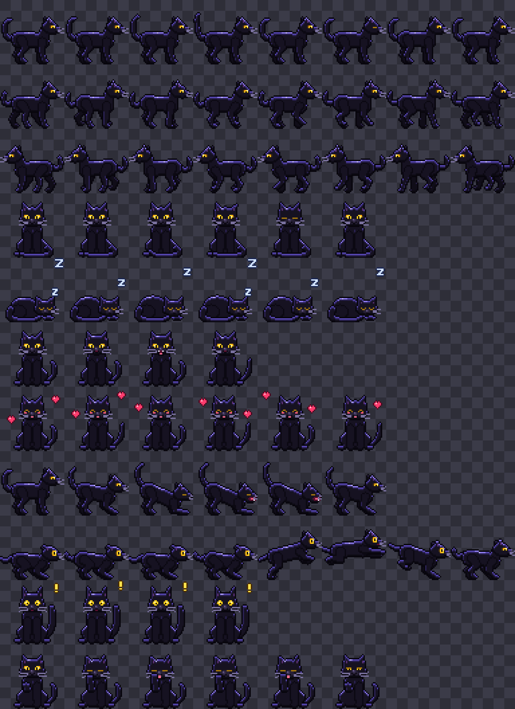

# 🐾 Shadow — your pixel-art black panther desktop pet

Shadow is an **original** pixel-art black panther who lives on top of all your windows, patrols the
bottom of your screen, naps when you're away, talks in Hinglish, and nags you about reminders.

**Everything works offline.** The only thing that ever goes online is chat, and only after you give
Shadow an AI brain in Settings. Free options are built in (see the end of this file).



---

## 1. Setup (one time)

You need **Node.js 22+** (you have 24). In a terminal in this folder:

```bash
npm install
```

Then run Shadow:

```bash
npm start
```

Shadow appears just above your taskbar, and a small panther-head icon shows up in the system tray
(click the `^` arrow near the clock if you don't see it).

> First `npm start` after a fresh `npm install` downloads the Electron runtime once (~100 MB).

## 2. What Shadow does

| You do | Shadow does |
| --- | --- |
| Nothing | Wanders along the bottom of the screen at varying speeds, sits, grooms, stretches, pounces |
| Click | Turns to you, talks, shows a random greeting bubble |
| Double-click | Purrs with floating hearts 💜 |
| Right-click | Small menu: **Sit, Sleep, Pounce, Chat…, Tuck Away** |
| **Ctrl + Click** | Opens the mini chat panel |
| Drag | Picks Shadow up. Drop near the floor → falls back down; drop high → perches there for a while |
| No mouse/keyboard for 5 min | Curls up and sleeps with floating Zzz |
| Mouse comes near a sleeping Shadow | Wakes up with a stretch |
| Every 20–40 min | Says a random idle quip (unless muted) |
| Reminder time | Walks to the centre-bottom of the screen, plays the alert animation, shows the message until you click it |
| Google Calendar event coming up | Same reminder: 10 min before ("in 10 mins") and when it starts (see section 8) |

Clicks on the **transparent** parts of Shadow's window pass straight through to whatever is behind it.
Only the panther itself (and its speech bubble) catch the mouse.

### Tray menu (panther head icon)

- **Wake Pet / Tuck Away Pet**: hide or show Shadow (the animation loop pauses while tucked away, so it uses ~0 CPU)
- **Chat…**: opens the chat panel
- **Mute Quips**: no spontaneous lines (clicks and reminders still talk)
- **Size**: 1x / 2x / 3x
- **Open Settings**, **Open Config Folder**
- **Start with Windows**: on/off (uses Electron's login-item setting = your user's Startup entry)
- **Quit**

### Settings window

Pet name · size · quip frequency (every _X_ to _Y_ minutes) · sleep timeout · mute quips ·
start with Windows · **Google Calendar** (secret iCal link, minutes-before, **Test Link** button) ·
**AI Brain** (chat provider, API key, model, and a **Test Brain** button).

Settings are saved to `%APPDATA%\Shadow\settings.json`. That's deliberately *outside* the project
folder, so an API key never lands in your code.

---

## 3. Editing Shadow's personality, quips and reminders

All three live in the **config folder** (tray → **Open Config Folder**):

| Running from | Config folder |
| --- | --- |
| `npm start` (this project) | `config/` in this project |
| Installed `.exe` | `%APPDATA%\Shadow\config\` (copied from the defaults on first run) |

**Save the file and Shadow reloads it within a second.** No restart needed. If you make a JSON typo,
Shadow tells you in a speech bubble and keeps using the last good version.

### `config/quips.json`

Lines grouped by category. Add, remove or edit freely:

```json
{
  "greetings": ["Arre Prince! Finally you noticed me. 😼", "..."],
  "idle": ["Prince, paani piya? Hydrate karo, founder saab.", "..."],
  "wakeup": ["..."],
  "sleepy": ["..."],
  "happy": ["..."],
  "drag": ["..."],
  "reminderDone": ["..."]
}
```

- `greetings`: single-click · `idle`: every 20–40 min · `wakeup` / `sleepy`: waking / dozing off
- `happy`: double-click · `drag`: sometimes when picked up · `reminderDone`: after you dismiss a reminder
- `{name}` is replaced with the pet's name from Settings.

### `config/reminders.json`

```json
{
  "reminders": [
    { "time": "09:00", "days": ["Mon", "Tue", "Wed", "Thu", "Fri"], "message": "Prince, attendance time!" },
    { "time": "22:30", "days": "daily", "message": "Screens down soon, Prince." }
  ]
}
```

- `time`: 24-hour `"HH:MM"`.
- `days`: any of `Mon Tue Wed Thu Fri Sat Sun`, or `"daily"`, `"weekdays"`, `"weekends"`. Leave it out for every day.
- `"enabled": false` pauses a reminder without deleting it.
- Each reminder fires once per day. If Shadow is tucked away it pops back out, and if it's asleep it wakes up.
  The bubble stays until you **click it** (or click Shadow).

### `config/personality.md`

Shadow's personality sheet: confident, loyal, protective, a little sarcastic, playful, casual
Hinglish, always calls you "Prince". It becomes the AI's instructions when you chat (see section 7).
Edits apply from the next message.

---

## 4. Build the Windows installer

```bash
npm run build
```

This regenerates the sprites, then uses **electron-builder** to create
`dist/Shadow-Setup-1.0.0.exe`, a normal Windows installer with the panther-head icon, a Start-menu
entry and a desktop shortcut. Run it to install Shadow like any other app. (The first build downloads
electron-builder's NSIS tools, about 1–2 minutes.)

Windows SmartScreen may warn "unknown publisher" because the installer isn't code-signed. Click
**More info → Run anyway**.

---

## 5. Testing

```bash
npm test
```

Runs 233 automated end-to-end checks against the real app (~1.5 min) in a **throw-away profile**.
Your settings, config and Start-with-Windows setting are never touched. The checks cover window
properties, every animation frame, click-through hit-testing, click/double-click/Ctrl+Click, dragging and
clamping, wandering and pouncing, sleep and wake, the right-click menu, the chat → `askPet()` round trip,
the quips, reminders (fire, hot-reload, broken JSON), Google Calendar reminders (against a fake local
calendar server), every tray item, the settings window, no network
requests, and low CPU. While it runs, the test panther ignores your real mouse.

Dev helpers:

```bash
npm run sprites
```

Regenerates `assets/sprites.png` and the icons from `scripts/generate-sprites.js`.

To log Shadow's state and position every half second while it runs, set `SHADOW_DEBUG=1`
(or `SHADOW_DEBUG=still` to also keep it sitting in one spot). In Git Bash:

```bash
SHADOW_DEBUG=1 npm start
```

---

## 6. Project layout

```
main/            Electron main process
  main.js          entry: windows, IPC, wiring
  ai.js            ★ chat brain: Gemini / Groq / OpenRouter / Ollama / Claude / custom
  brain.js         behaviour state machine (wander/sit/groom/stretch/pounce/sleep/reminders)
  petWindow.js     transparent click-through window, screen bounds, multi-monitor
  config.js        quips/reminders/personality loading + live reload
  reminders.js     reminder clock
  calendar.js      Google Calendar reminders (reads the secret iCal link)
  updater.js       self-update from GitHub Releases
  tasks.js         "remind me…" reminders, to-do list, morning briefing
  search.js        internet search (Tavily / Wikipedia) + "google …"/"youtube …" commands
  apps.js          opens apps/folders/settings; lock, sleep, screenshot, volume, brightness
  settings.js      settings.json load/validate/save
  tray.js          tray icon + menu
  windows.js       chat panel + settings window
  selftest.js      `npm test`
  preload/         secure bridges (contextIsolation + sandbox)
renderer/
  pet/             sprite player, speech bubbles, hit-testing
  chat/            mini chat panel
  settings/        settings window
  fonts/           pixel fonts (Pixelify Sans, Press Start 2P - OFL), bundled for offline use
assets/          sprites.png + sprites.json, icon.ico/png, tray icons (generated)
config/          quips.json, reminders.json, personality.md (defaults)
scripts/         generate-sprites.js (+ tiny PNG/ICO encoder), copy-fonts.js
```

### Notes and choices I made where the brief was open

- **Sprites** are drawn by code (`scripts/generate-sprites.js`) with a tiny built-in PNG encoder
  instead of the `canvas` package. Same result, but no native compilation step that can break on Windows.
- Shadow is a **window that walks** (it moves itself), not a full-screen overlay. That keeps it cheap and
  avoids confusing Windows' fullscreen detection.
- Pixel animation is capped at **12 fps**. Window movement updates at 30 fps so walking looks smooth.
- **Mute Quips** silences *spontaneous* lines only. Clicking Shadow and reminders still talk.
- Dragged high and dropped, Shadow **perches** there for a bit, then hops down.
- Shadow can't be dragged so close to the top edge that its speech bubble would go off-screen.
- If anything minimizes Shadow (e.g. Win+D "Show desktop"), it pops right back. It also re-asserts
  "always on top" every few seconds so other always-on-top apps don't bury it.

---

## 7. Give Shadow a brain (AI chat), free options included

Ctrl+Click Shadow (or tray → **Chat…**) to open the chat panel. Replies show in the panel *and* in
Shadow's speech bubble. Until you pick a brain, Shadow just explains how to add one, and nothing goes online.

### Quick start (free, about 2 minutes)

1. Tray icon → **Open Settings** → scroll to **AI Brain**.
2. Pick a **Provider** (Google Gemini is the default and recommended).
3. Click **GET A FREE KEY ↗**, sign in, create a key and copy it.
4. Paste it into **API key** → click **TEST BRAIN** → you should see `✓ Works!` and a hello from Shadow.
5. Click **SAVE**. Done: Ctrl+Click Shadow and chat.

### Which provider?

| Provider | Cost | What you need | Recommended model (auto) | Good to know |
| --- | --- | --- | --- | --- |
| **Google Gemini** | Free tier | Google account → key from AI Studio | `gemini-3.5-flash-lite` | No card. Daily free limit (shown in AI Studio). Google may use free-tier chats to improve its products. |
| **Groq** | Free tier | Groq account → key | `llama-3.3-70b-versatile` | No card, very fast. Daily limits (shown in your Groq console). |
| **OpenRouter** | Free models | OpenRouter account → key | `openrouter/free` | 50 free messages/day. `openrouter/free` auto-picks a free model that's up. |
| **Ollama** | Free, private | Install Ollama, then `ollama pull gemma3:4b` (3.3 GB) | `gemma3:4b` | **No key, no internet, nothing leaves your PC.** Slower on laptops without a good GPU. |
| **Claude** (Anthropic) | Paid (~₹1/message) | Key from console.anthropic.com + `npm install @anthropic-ai/sdk` | `claude-opus-5-5` | Best quality. Set Model to `claude-sonnet-5-5` for about half the price. |
| **Custom** | — | Any OpenAI-compatible API: Base URL (ending in `/v1`) + Model | — | Key optional. |

- Leave **Model** blank to use the recommended one, or type any model name that provider offers.
- Each provider keeps its own key, so you can switch back and forth without re-pasting.
- Keys are stored only in `%APPDATA%\Shadow\settings.json` on this PC, never in the project folder.
  Treat them like passwords.

### How it works

All AI code lives in [`main/ai.js`](main/ai.js):

- The system prompt is [`config/personality.md`](config/personality.md) plus rules that keep replies to
  1–2 short, plain-text sentences for the speech bubble. Edit the personality file and the next message uses it.
- The last 20 chat turns are sent along, so Shadow remembers the conversation while the app is open.
- Gemini, Groq, OpenRouter, Ollama and Custom all use the standard OpenAI-style `/chat/completions`
  API via plain `fetch`, so no extra packages are needed. Claude uses Anthropic's official SDK, with
  automatic fallback if a harmless message is wrongly declined.
- Nothing ever crashes Shadow: no key, a wrong key, no internet, a used-up free quota, an unknown model or
  Ollama not running each turn into a friendly, in-character line.
- To add another provider, add an entry to `PROVIDERS` at the top of `main/ai.js`. If it's
  OpenAI-compatible, that's all it takes.

After changing providers or code, `npm run build` makes a new installer with the brain included.

---

## 8. Google Calendar reminders

Shadow can read your Google Calendar and remind you before each event, using the same walk-to-centre,
alert, sticky-bubble reminder as `reminders.json`.

### Connect it (one time, about 2 minutes)

1. Open **Settings → Google Calendar** and click **OPEN GOOGLE CALENDAR SETTINGS** (or go to
   calendar.google.com → ⚙ → **Settings**).
2. On the left, under **Settings for my calendars**, click your calendar, then **Integrate calendar**.
3. Copy the **Secret address in iCal format** (it ends in `basic.ics`). This is *not* the "Public address".
4. Paste it into **Secret iCal address**, click **TEST LINK** (it should say ✓ Works! and show your next
   event), then **SAVE**.

Have more than one calendar? Each Google calendar has its own secret address. Shadow reads one, usually
your main one.

### What Shadow does

| When | Shadow says |
| --- | --- |
| 10 min before (change it in Settings; 0 = off) | ⏰ Prince! "Maths class" in 10 mins (Room 4) |
| When it starts (tick box in Settings) | ⏰ Prince! "Maths class" is starting now |
| All-day events, at 9:00 that day | ⏰ Today: "Mom's birthday" 📅 |

- Repeating events, events you moved or deleted once, and time zones are handled. Cancelled events and
  invitations you said **No** to are skipped.
- Click the bubble to dismiss it, like any reminder.
- If the PC was asleep and wakes up just before an event, you still get a reminder ("in 3 mins"). Events
  that already started more than 5 minutes ago stay quiet.

### Ask Shadow about your calendar

Ctrl+Click Shadow and ask things like *"what's on tomorrow?"*, *"am I free at 3?"* or *"when is my next
maths class?"*. The chat sees today's events and the next 2 weeks (titles, times, places), plus the current
date and time.

- This sends those events to your **AI Brain** provider (Gemini, Groq, ...) along with each message.
  Untick **Let chat answer questions about my calendar** in Settings to stop that; reminders still work.
  With **Ollama**, nothing leaves your PC.
- Shadow can't add or move events from chat. It will tell you to do that in Google Calendar.

### Good to know

- **Read-only.** Shadow can only *read* your calendar. It can't change or add anything.
- **The link is a secret.** Anyone who has it can see your events. Shadow keeps it in
  `%APPDATA%\Shadow\settings.json` on this PC only (never in the project folder, never in logs). If it ever
  leaks, click **Reset** next to the secret address in Google Calendar and paste the new one.
- **Checks every 5 minutes**, so a brand-new event can take a few minutes to show up. Google itself
  sometimes takes a bit longer to update the link.
- **Needs internet to check.** The next 2 weeks of events are cached in
  `%APPDATA%\Shadow\calendar-cache.json`, so reminders keep working offline and after a restart.
- **Shadow has to be running.** Turn on **Start with Windows** so you never miss one.
- No link = calendar off, and Shadow makes no calendar requests at all.

The code is in [`main/calendar.js`](main/calendar.js). It works with any iCal link, so an Outlook or
Apple calendar's published `.ics` link works too.

---

## 9. Automatic updates

The installed Shadow updates itself. There's no need to `git pull` or `npm run build` on your PC anymore.

1. Every push to `main` makes GitHub build a new installer
   ([`.github/workflows/release.yml`](.github/workflows/release.yml)) and publish it under **Releases**
   as version `1.0.<build number>`. Changes that only touch `.md` files don't trigger a build.
2. Shadow checks a minute after it starts and then every 4 hours, and downloads new versions quietly.
3. When one is ready, Shadow walks out with a ✨ bubble:
   - **Click the bubble** (or tray → **Restart to Update**) to restart into the new version right away.
   - **Ignore it**, or pick **Update Later** from the right-click or tray menu, and it installs the next time
     Shadow quits or the PC shuts down.
4. **Settings → Updates** shows your version and has a **Check for updates** button.

Notes:

- The repo must be **public** so the installed app can download releases without a password. No keys,
  calendar links or settings are in the repo. They live only in `%APPDATA%\Shadow` on your PC.
- Only the installed app updates. `npm start` and `npm test` never do.
- Building an installer yourself with `npm run build` still works (it's version 1.0.0, so the next release
  replaces it).

---

## 10. Reminders, to-do list and morning briefing (from chat)

Ctrl+Click Shadow and just say it. These commands work instantly, **even without an AI key or internet**:

| Say | What happens |
| --- | --- |
| `remind me in 20 min to drink water` | ⏰ reminder in 20 minutes (also `in 2 hours`, `in half an hour`) |
| `remind me at 6 pm to call Mom` | today at 6 PM (tomorrow if 6 PM has passed) |
| `remind me tomorrow at 7:30 am to go running` | tomorrow morning |
| `remind me to submit the form tomorrow at 9` | the "what" can come first too |
| `my reminders` · `cancel reminder 2` | list / cancel |
| `todo: physics homework` · `add buy milk to my list` | add to your to-do list |
| `show my list` · `done 2` · `remove 3` | list / tick off / delete (numbers as shown in the list) |

- Without am/pm, `at 1`–`at 6` means afternoon/evening; `at 7`–`at 11` means the next one coming up.
  Shadow always replies with the exact time it set, so you can check.
- With an AI brain connected you can also say things in your own words ("wake me up for gym tomorrow at 7",
  "I finished the milk thing"). The AI sees your list and reminders and changes them for you, and
  Shadow confirms what it did.
- Reminders use the same walk-out bubble as everything else. If the PC was asleep, you still get it with
  "(was due 6:00 PM)". Reminders more than a day old are dropped.
- Stored only on your PC in `%APPDATA%\Shadow\tasks.json`.

**Morning briefing:** the first time you're at the PC each day (from 5 AM), Shadow walks out with a
**YOUR DAY** bubble: today's calendar events, how many to-dos are open, and today's reminders.

**To-do nudges:** now and then (at most every 2 hours) an idle quip becomes a nudge about an open to-do.

Both can be switched off in **Settings → Behaviour**.

---

## 11. Internet search

Shadow can look things up. Ctrl+Click and:

| Say | What happens |
| --- | --- |
| `google best laptops under 50k` | opens the Google search in your browser |
| `youtube lofi music` · `play arijit singh songs` | opens YouTube search |
| `open whatsapp` (also youtube, gmail, maps, instagram, github, spotify, netflix, amazon, flipkart, …) | opens the site |
| `wiki black panther` | answers from Wikipedia, with a link |
| `search for IPL 2026 final` · `look up weather in Delhi` | searches and answers with sources |
| any question, e.g. *"who won yesterday's match?"* | the AI decides when it needs to search, then answers from the results |

- **Wikipedia works without any key.** For news, scores, weather and everything else, add a free
  **Tavily** key in **Settings → Internet search** (1,000 searches a month, no card). Click
  **GET A FREE TAVILY KEY**, sign up, copy the key (starts with `tvly-`), paste it, then click **TEST SEARCH** and **SAVE**.
- Sources show as 🔗 links under the answer in the chat panel. Click to open them in your browser.
- Answers need an AI brain (Settings → AI Brain). Without one, `search for …` lists the top results.
- Web pages are treated as untrusted: anything they say only informs the answer. They can't make Shadow
  set reminders or change your list.
- Your searches are sent to Tavily or Wikipedia. Untick **Let Shadow look things up on the internet** to turn it off.

---

## 12. Opening apps and controlling the PC

Ctrl+Click Shadow and:

| Say | What happens |
| --- | --- |
| `open spotify` · `launch vs code` · `start whatsapp` | opens any app in your Start menu (nicknames and small typos are fine) |
| `open microsoft` | if several apps match, Shadow asks *"Which one? 1. … 2. …"*. Reply with the number |
| `open downloads` · `documents` · `desktop` · `pictures` · `music` · `videos` · `screenshots` · `recycle bin` · `this pc` | opens the folder |
| `open settings` · `wifi settings` · `bluetooth settings` · `display/sound/battery settings` · `windows update` | opens that Settings page |
| `open google` / `open youtube` (no app with that exact name) | opens the website |
| `lock my pc` | locks right away |
| `sleep my pc` | sleeps after 5 seconds. Say `cancel` to stop it |
| `take a screenshot` | saves the screen to *Pictures › Screenshots* (Shadow steps out of the picture) |
| `snip` | opens the Windows snipping overlay (copies to the clipboard) |
| `volume up` · `volume down` · `mute` | sound |
| `brightness 60` · `brightness up` / `down` | laptop screen brightness |

With an AI brain you can also say things in your own words, like *"I want to study, set things up"*, and the
AI can open apps for you.

**Safety:**
- Apps come only from Windows' own Start-menu list and open through Explorer. Nothing you, the AI or a
  web page types is ever run as a command.
- System actions are a fixed list of built-in commands.
- Shadow can't close apps, shut down, restart or delete anything.
- Switch it all off in **Settings → Behaviour → Let Shadow open apps & folders…**
